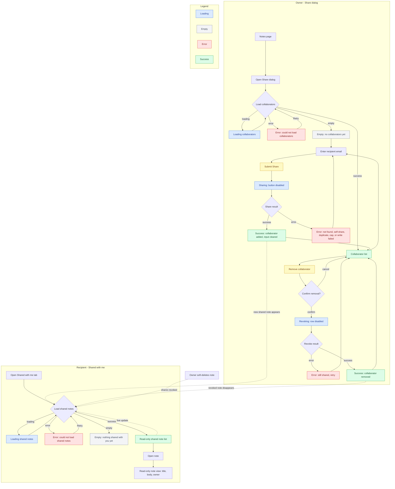
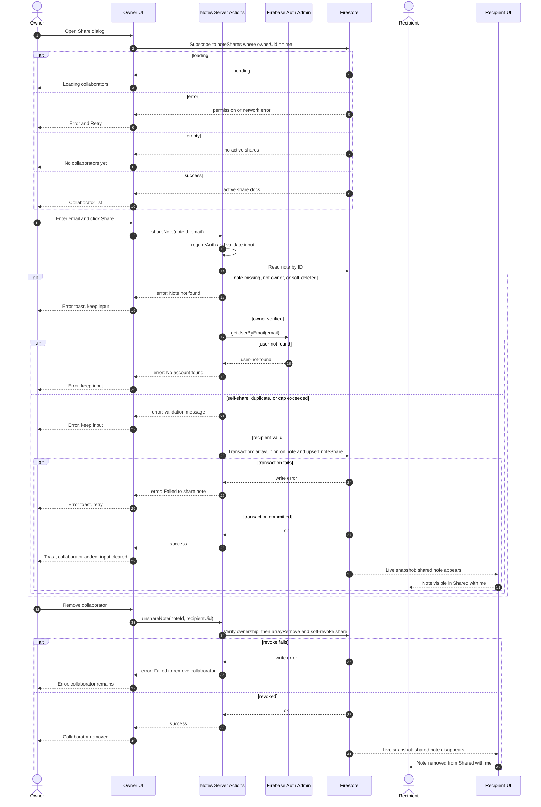

# Note Sharing — Flow and UI States

## Scope

- **View-only sharing**: recipients can read a shared note but cannot edit or delete it.
- **Recipient must already have an account**: the recipient is resolved by email through Firebase Auth.
- **Soft revoke**: share records are marked with `revokedAt`; they are never hard-deleted.
- **Server-authoritative writes**: sharing and revoking go through Server Actions using the Admin SDK.
  Clients cannot write directly to `noteShares`.
- **Live UI**: Firestore `onSnapshot` subscriptions update the owner's collaborator list and the
  recipient's "Shared with me" list without a refresh.

---

## 1. UI state flow

---

## 2. End-to-end sequence

---

## 3. State coverage checklist

| Surface                      | Loading                                                             | Empty                                                     | Error                                               | Success                                                    |
| ---------------------------- | ------------------------------------------------------------------- | --------------------------------------------------------- | --------------------------------------------------- | ---------------------------------------------------------- |
| Share dialog — collaborators | Spinner/skeleton; actions disabled                                  | “No one else has access yet”, email input still available | “Couldn’t load collaborators” + Retry               | Collaborator rows with remove actions                      |
| Share submit                 | Button spinner, input disabled                                      | —                                                         | Inline/toast error; keep email so it can be retried | Toast “Shared with X”; input cleared; collaborator appears |
| Remove collaborator          | Row spinner, remove button disabled                                 | —                                                         | Toast “Couldn’t remove access”; row remains         | Toast “Access removed”; row disappears                     |
| Shared with me               | Skeleton/spinner                                                    | “Notes shared with you will appear here”                  | “Couldn’t load shared notes” + Retry                | Read-only note cards                                       |
| Shared note view             | Renders from the list; show spinner only if opened via a direct URL | —                                                         | Direct-URL fetch failure: error + Back/Retry        | Title, body, owner name; no edit/delete controls           |

---

## Key transitions

- **Share succeeds**: the transaction updates `notes.sharedWithUids` and creates/updates the
  `noteShares` document. The recipient’s live `array-contains` query picks up the note without a
  refresh.
- **Revoke succeeds**: `sharedWithUids` loses the UID and the share document gets `revokedAt` set.
  The recipient’s list updates live and security rules deny further access.
- **Owner soft-deletes**: shares are cleared/revoked in the same server operation, so recipients
  immediately lose access.
- **Session expires**: `requireAuth()` redirects to sign-in; the UI should treat this as a
  terminal error rather than an inline retry.
- **All share writes go through Server Actions**: client writes to `noteShares` are denied by
  rules, so the UI cannot bypass recipient lookup or ownership checks.

---

## Data touched

| Collection                           | Access        | Purpose                                                                 |
| ------------------------------------ | ------------- | ----------------------------------------------------------------------- |
| `notes/{noteId}`                     | Read + update | Existing note; `sharedWithUids` is the queryable access list.           |
| `noteShares/{noteId}_{recipientUid}` | Read + write  | Collaborator metadata, owner display name, and `revokedAt` audit state. |
| `users/{uid}`                        | Read          | Optional display-name lookup server-side; Auth resolves the recipient.  |

---

## Implementation checklist

- [ ] Add `sharedWithUids?: string[]` and `NoteShare` to the Firestore types and schema docs.
- [ ] Add `shareNote`, `unshareNote`, and share cleanup in `deleteNote` as Server Actions.
- [ ] Update Firestore rules for owner-or-shared note reads and owner/recipient share reads.
- [ ] Build the share dialog with loading, empty, error, and success states.
- [ ] Add the “Shared with me” tab and read-only shared note view.
- [ ] Add action, component, and rules tests covering the error paths above.
- [ ] Verify the two-account demo, including live share and revoke updates.
